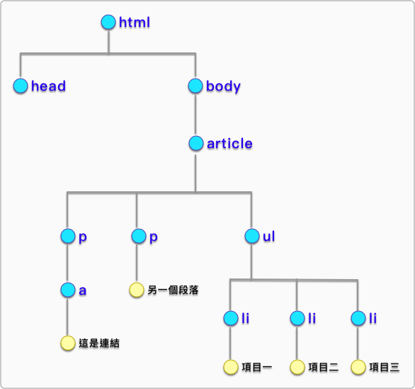
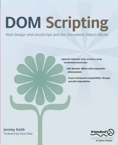

# 4.1 DOM 介紹

DOM = Document Object Model，中文即「文件物件模型」。

## DOM tree

建立 `jquery/practice/dom.html` 檔案，內容如下：

```html
<!DOCTYPE html>
<html>
  <head>
  </head>
  <body>
    <article>
      <p><a href="#">這是連結</a></p>
      <p>另一個段落</p>
      <ul>
        <li>項目一</li>
        <li>項目二</li>
        <li>項目三</li>
      </ul>
    </article>
  </body>
</html>
```

瀏覽器解析以上 html 後，產出的 DOM tree：



### 解析錯誤？

試著加上以下的原始碼(可放在 `</body>` 之前)：

```html
<p>這是段落<div>這是 div 區塊</div></p>
```

再到上述提的 Elements 頁籤觀察看看，出了什麼問題？


## DOM Scripting

javascript 本身並沒有 window、document 這種物件，這是瀏覽器解析完之後，提供給開發人員使用的，例如：

window.alert()

document.getElementById()

元素.setAttribute()

元素.getAttribute()

以上這些其實都是 **DOM Scripting。**

<div align="left"><figure><figcaption></figcaption></figure></div>

